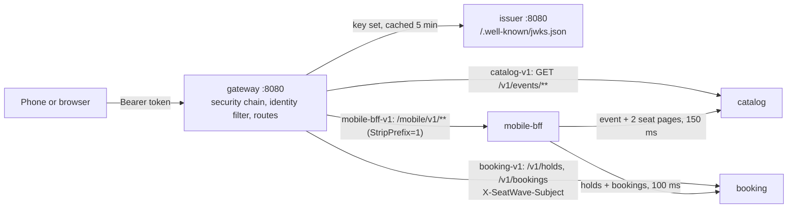

# Architecture

Module 11 of System Design Fundamentals puts an API gateway in front of SeatWave, which is now two
services, and adds a mobile backend-for-frontend (BFF) behind it. This file says how the code is
cut, which way dependencies point, how one request flows, what was decided and why, and where
each rule is enforced.

## Packages

Six Gradle programs, each one package under `io.plainround.seatwave.gateway`:

| Program | Package | What it holds |
|---|---|---|
| `gateway` | `edge` | Spring Cloud Gateway Server Web MVC routes (`application.yaml`), the security chain (`SecurityConfiguration`), the token decoder and its claim rules (`CheckedJwtDecoder`, `TokenClaimsRules`, `TokenRefusal`, `RefusedTokenException`), the refusal writer (`ProblemResponses`), the identity filter (`IdentityHeaderFilter`, `IdentityRequest`), the settings (`GatewayProperties`) |
| `catalog` | `catalog` | Events and their seat pages, read-only (`CatalogController`, `SeatCatalog`, `SeatQuery`, `SeatPage`, `Seat`, `Event`, `CatalogProperties`) |
| `booking` | `booking` | The booking stand-in: holds in memory (`BookingController`, `HoldBook`, `Hold`, `HoldCommand`, `HoldRefusal`, `BookingProperties`) |
| `mobile-bff` | `bff` | The seat screen (`SeatScreenController`, `SeatScreenService`, `SeatScreen`), one REST client per service (`BackendClients`, `CatalogClient`, `BookingClient`), `MobileBffProperties` |
| `issuer` | `issuer` | The token issuer stand-in: key set and signing (`TokenController`, `KeyRing`, `KeyRingCli`, `IssuerProperties`) |
| `labtools` | `labtools` | JDK-only teaching programs: `TokenChecker` and `TokenWalk`, `TokenCheckCost`, `FanOutDemo` with `ScreenFetcher` and `StubServices`, `LatencyProbe` |

## The dependency rule

No program depends on another program's code. They talk only over HTTP, and the contract between
them is the module's: the gateway sends `X-SeatWave-Subject` inward and never `Authorization`; the
services trust that header and nothing else. Inside each program, controllers translate HTTP into
domain calls and back; `HoldBook`, `SeatCatalog`, `SeatScreen` and `TokenChecker` hold the rules
and know nothing of HTTP. The lab tools use the JDK alone.

## Data flow

Only the gateway (21100, management 21101) and the issuer (21102) publish ports, on 127.0.0.1.

## Walk-through: one hold

1. `POST /v1/holds` with a bearer token arrives at the gateway's Tomcat on port 8080.
2. Spring Security's chain runs first (`SecurityConfiguration.edge`): the path needs an
   authenticated token. `CheckedJwtDecoder` refuses a token that is not ES256 with a key id; the
   Nimbus decoder verifies the signature against the issuer's key set; `TokenClaimsRules` checks
   the required claims, expiry and not-before with 30 s of skew, the issuer and the audience. A
   refusal ends here as `401` (or `503` when the key set cannot be fetched), written by
   `ProblemResponses`, which counts it by reason.
3. `IdentityHeaderFilter` wraps the request in an `IdentityRequest`: `Authorization` and every
   client-sent `X-SeatWave-*` header are gone in any spelling, and `X-SeatWave-Subject` carries the
   verified `sub`.
4. The route `booking-v1` matches by path and method and proxies the request to booking.
5. Booking checks the subject's form, the key and the seat, and `HoldBook` grants or refuses the
   hold under one lock.

## Where a new filter goes

The gateway's request path has three ordered places, by servlet filter order:

| Order | What runs | Where it is registered |
|---|---|---|
| `SecurityFilterProperties.DEFAULT_FILTER_ORDER` | Spring Security's chain: the token check | Spring Boot, built by `SecurityConfiguration.edge` |
| `DEFAULT_FILTER_ORDER + 1` | `IdentityHeaderFilter`: the identity header | `SecurityConfiguration.identityHeaderFilter` |
| `DEFAULT_FILTER_ORDER + 2` and later | a filter that needs the verified fan, such as Module 12's rate limiter | its own `@Configuration` with a `FilterRegistrationBean` and that order |
| the route's `filters:` list in `application.yaml` | a change to one route only (for example `StripPrefix=1`) | `application.yaml` |

A filter registered as a servlet filter runs for every request, so a new route cannot skip it. A
filter that must run before the token check (a coarse per-address limit) takes an order below
`DEFAULT_FILTER_ORDER`. Section 6e's checklist of the module decides whether a job belongs in the
gateway at all.

## Decisions and trade-offs

- **Server Web MVC, not WebFlux.** With virtual threads a blocking proxy holds no platform thread
  while it waits, and the code reads as plain servlet code. The reactive variant would scale the
  same on this load and cost a second programming model.
- **One decoder that wraps Spring's.** The header rules (ES256 only, a key id) are checked in this
  repository's code, so the allowed algorithm is a tested rule and the metric can tell
  `algorithm` from `signature`; the signature and key-set handling stay Spring Security's.
- **Fail safe on the key set.** An unreachable key set is `503 key-set-unavailable` with
  `Retry-After`, never "let it through".
- **Error forwards are permitted.** A request that was admitted and then answered `404` by Boot's
  error page passes the chain a second time; `dispatcherTypeMatchers(ERROR).permitAll()` stops
  deny-by-default from turning that 404 into a 401. Found by the stack test.
- **Timeouts per part in the BFF.** The seat map is essential (150 ms); holds and bookings are
  optional (100 ms) and make the screen partial instead of failing it. A cold catalog can miss the
  150 ms on the first screens after a start, which the BFF answers `503` with `Retry-After`.
- **In-memory booking.** The stand-in keeps holds in memory (a `ponytail` comment says so); the
  real SeatWave keeps Module 10's PostgreSQL tables.
- **The issuer stand-in checks no password.** It exists so the gateway has a real key set to fetch;
  Module 38 replaces it with a real identity provider.

## Invariants and where they are enforced

| Invariant | Enforced in | Tested by |
|---|---|---|
| No request reaches booking or the BFF without a valid token | `SecurityConfiguration`, `CheckedJwtDecoder`, `TokenClaimsRules` | `EdgeInvariantTest`, `TokenClaimsRulesTest`, `CheckedJwtDecoderTest`, `StackTest` |
| An unreachable key set refuses, never admits | `CheckedJwtDecoder`, `ProblemResponses` | `KeySetUnavailableTest`, `CheckedJwtDecoderTest` |
| A client cannot set its own identity | `IdentityRequest` | `EdgeInvariantTest.replacesASubjectHeaderTheClientSentItself`, `StackTest` |
| Unrouted paths are refused | `anyRequest().denyAll()` | `EdgeInvariantTest`, `StackTest` |
| One active hold per seat; a repeated key replays | `HoldBook` under one lock | `HoldBookTest` (32 racing fans), `BookingHttpTest` |
| A fan sees only their own holds | `HoldBook.activeHolds`, `BookingController` | `HoldBookTest`, `BookingHttpTest` |
| A partial flag matches the missing list | `SeatScreen`'s compact constructor | `SeatScreenServiceTest` |
| The issuer signs only with a private P-256 key with an id | `KeyRing` | `KeyRingTest` |
| Every setting is checked at start-up, broken rules together | the `*Properties` records | `CatalogPropertiesTest`, `BookingPropertiesTest`, `IssuerPropertiesTest` |
| Services are reachable only through the gateway | `compose.yaml` publishes only the gateway and the issuer | `StackTest` (by the ports it can reach) |
